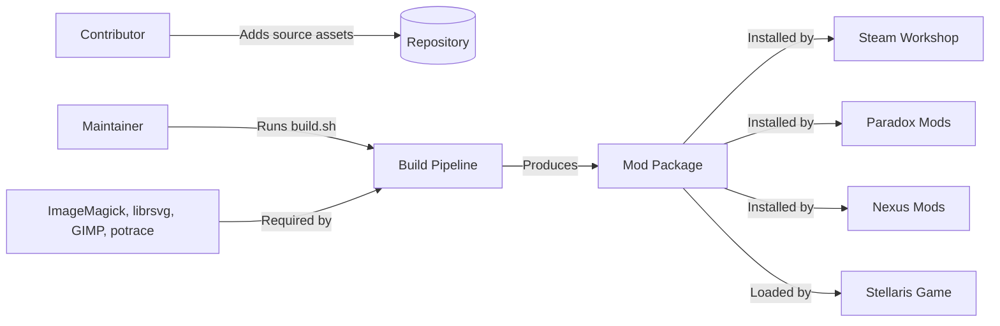
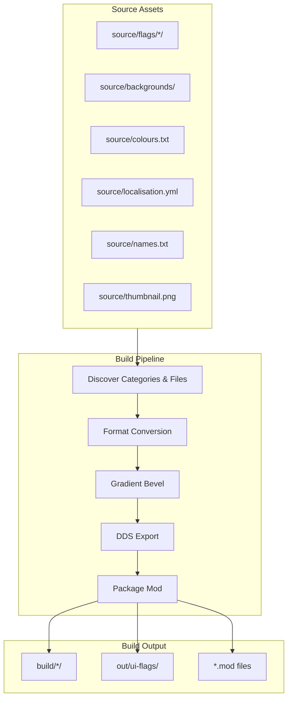
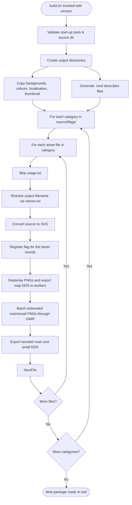
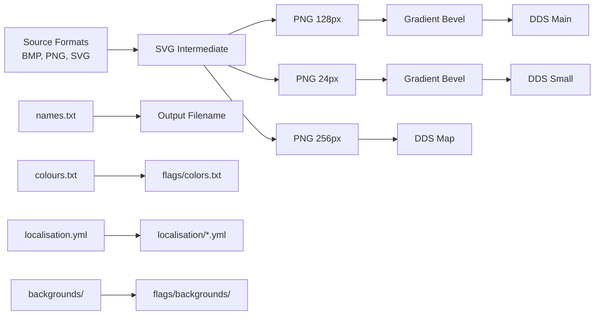
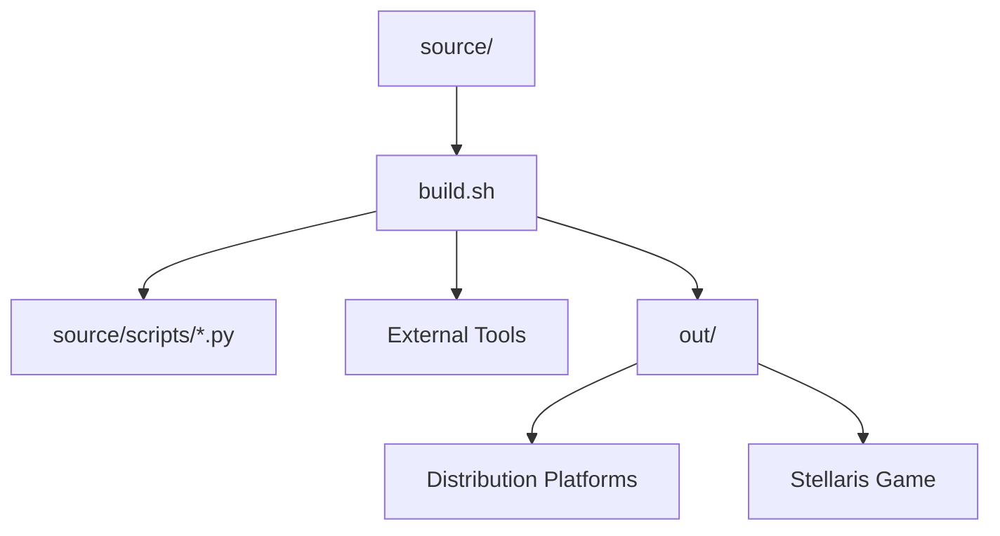

# Stellaris UI Flags Architecture

This document describes the current architecture of the Stellaris UI Flags mod repository. The repository contains source assets and a build pipeline that produces a Stellaris-compatible mod package.

## 📑 Table of Contents

- [Purpose](#purpose)
- [System Context](#system-context)
- [Architectural Style](#architectural-style)
- [Runtime Process](#runtime-process)
- [Architectural Areas](#architectural-areas)
  - [Source Assets](#source-assets)
  - [Build Pipeline](#build-pipeline)
  - [Output Package](#output-package)
- [Data Architecture](#data-architecture)
- [Interfaces and Integrations](#interfaces-and-integrations)
- [Dependency Direction and Rules](#dependency-direction-and-rules)
- [External Dependencies](#external-dependencies)
- [Deployment and Operations](#deployment-and-operations)
- [Compatibility Contracts](#compatibility-contracts)
- [Testing and Verification](#testing-and-verification)
- [Design Constraints](#design-constraints)
- [Extension Points](#extension-points)
  - [New Flag Category](#new-flag-category)
  - [New Source Format](#new-source-format)
  - [New Output Resolution](#new-output-resolution)
- [Source Map](#source-map)
- [Related Documentation](#related-documentation)

## 🎯 Purpose

The repository provides a mod for Stellaris that adds hundreds of new flag designs matching the vanilla flag style. The architecture encompasses the source asset organisation, the build pipeline that converts source images to the DDS format required by Stellaris, and the packaging process that produces a distributable mod directory and descriptor files.

Audience: mod maintainers, contributors adding new flag assets, and users building the mod locally.

## 🌐 System Context

The system boundary is the repository and its build script. External actors and systems:



The principal external boundaries are:
- **Source Assets:** Contributor-provided flag designs in various formats (BMP, PNG, SVG) organised by category directories under `source/flags/`.
- **Build Tools:** ImageMagick (`convert`, `magick`), librsvg, GIMP (3.0+), potrace, and Python 3 must be present on the build machine; GIMP is needed only for the bevels.
- **Distribution Platforms:** Steam Workshop, Paradox Mods, Nexus Mods consume the built mod package.
- **Stellaris Game:** Loads the mod package at runtime; expects DDS flag textures and localisation/colour definitions.

## 🏗️ Architectural Style

The repository follows a **pipeline-oriented asset processing architecture**:

- **Source-first organisation:** Assets are authored and stored in lossless or editable formats, grouped by thematic category.
- **Declarative build script:** `build.sh` encodes the complete conversion pipeline as a sequence of format transformations, driven by file discovery.
- **Immutable outputs:** The build writes to `build/` (intermediate) and `out/` (final) directories; source assets are never modified.
- **Category isolation:** Each flag category is processed independently, enabling parallelism and incremental builds.



The principal architecture boundaries are:
- **Source Area:** `source/` — authoring formats, category taxonomy, localisation, colour palette, naming map.
- **Build Pipeline:** `build.sh` + `source/scripts/` — conversion logic, tool orchestration, output layout.
- **Output Area:** `out/` — distributable mod package conforming to Stellaris mod structure.

## 🔄 Runtime Process



The principal runtime sequence is:
1. **Initialisation:** Validate the start-up tools (ImageMagick, librsvg, Python 3, potrace), verify source directory exists, parse version argument. GIMP is resolved lazily at the first bevel session.
2. **Static asset staging:** Copy backgrounds, colours.txt, localisation.yml, thumbnail.png to output layout; generate primary and secondary `.mod` descriptor files.
3. **Category iteration:** For each non-empty subdirectory under `source/flags/`, create build and output subdirectories (main, map, small).
4. **Asset conversion:** For each asset file, resolve final filename via `names.txt`, convert source format to SVG, rasterise the three PNG sizes (128px main, 256px map, 24px small) in parallel workers, export the map DDS immediately, batch the gradient bevels for main and small, then export the beveled main and small DDS.
5. **Completion:** Mod package resides in `out/ui-flags/` with descriptor files in `out/`.

## 🗂️ Architectural Areas

### Source Assets

Paths:
- `source/flags/` — category directories, each containing flag source files and optional `usage.txt`.
- `source/backgrounds/` — background textures copied verbatim to output.
- `source/colours.txt` — colour palette definitions copied to `flags/colors.txt` in output.
- `source/localisation.yml` — English localisation copied to `localisation/ui-flags_l_english.yml`.
- `source/names.txt` — mapping from source filename (without extension) to output filename.
- `source/thumbnail.png` — mod thumbnail copied to output root.
- `source/scripts/` — Python scripts for DDS export and the batched gradient bevel.

Responsibilities:
- Provide authoring formats and taxonomic organisation for flag designs.
- Define naming overrides, colour palette, and localisation strings.
- Supply reusable background textures and build-time scripts.

Boundary rules:
- Source files are never modified by the build.
- Category directories define the output category structure.
- `names.txt` is the single source of truth for output filenames.

### Build Pipeline

Paths:
- `build.sh` — top-level orchestration, tool detection, directory management, conversion loop.
- `source/scripts/*.py` — GIMP Python-Fu implementations for format conversions and effects.

Responsibilities:
- Detect and validate external tool dependencies.
- Manage intermediate (`build/`) and final (`out/`) directory trees.
- Execute conversion pipeline per asset: source → SVG → PNG (multiple sizes) → DDS.
- Apply the gradient bevel to main and small variants through batched GIMP sessions.
- Generate Stellaris mod descriptor files.

Boundary rules:
- All file paths are derived from repository root; no hardcoded absolute paths.
- Tool binaries are resolved via standard locations and Flatpak exports.
- Intermediate build artefacts are retained for incremental builds.

### Output Package

Paths:
- `out/ui-flags/` — root of distributable mod package.
- `out/ui-flags/flags/` — category subdirectories with `map/`, `small/`, and main DDS files.
- `out/ui-flags/flags/backgrounds/` — copied background textures.
- `out/ui-flags/flags/colors.txt` — copied colour palette.
- `out/ui-flags/localisation/ui-flags_l_english.yml` — copied localisation.
- `out/ui-flags/thumbnail.png` — copied thumbnail.
- `out/ui-flags.mod` and `out/ui-flags/descriptor.mod` — mod descriptors.

Responsibilities:
- Conform to Stellaris mod directory layout and descriptor format.
- Provide DDS textures at required resolutions (128px, 256px, 24px).
- Include all metadata required by distribution platforms.

Boundary rules:
- Output structure is fixed by Stellaris mod specification.
- Descriptor files must contain correct version, name, path, tags, and supported_version.

## 💾 Data Architecture



| Data or Store | Owner | Representation and Storage | Lifecycle or Consistency |
|---------------|-------|----------------------------|--------------------------|
| `source/flags/*/*.{bmp,png,svg}` | Contributor | Lossless/editable raster or vector files | Authored once; immutable during build |
| `source/names.txt` | Maintainer | `source_name=output_name` lines | Updated when new flags added; build reads only |
| `source/colours.txt` | Maintainer | Stellaris colour definitions | Copied verbatim to output |
| `source/localisation.yml` | Maintainer | YAML localisation keys/values | Copied verbatim to output |
| `source/backgrounds/*.dds` | Contributor | DDS textures | Copied verbatim to output |
| `build/*/` | Build Pipeline | Intermediate SVG, PNG, BMP, bevel logs | Ephemeral; recreated or reused each build |
| `out/ui-flags/flags/*/*.dds` | Build Pipeline | DDS (uncompressed BGRA8, written by `png_to_dds.py`) | Final artefacts; shipped to platforms |
| `out/ui-flags/*.mod` | Build Pipeline | Text descriptor | Regenerated each build with version |

## 🔌 Interfaces and Integrations

| Interface or Integration | Direction | Contract | Owner | Failure Semantics |
|--------------------------|-----------|----------|-------|-------------------|
| `build.sh` CLI | Inbound | `build.sh <version>` | Build Pipeline | Exits non-zero with error message if version missing, source missing, or a start-up tool absent |
| ImageMagick `convert`/`magick` | Outbound | PNG→BMP flattening, SVG→PNG alpha derivation, PNG pixel reads | Build Pipeline | Build fails if the binary is missing or a conversion fails |
| `rsvg-convert` | Outbound | SVG→PNG rasterisation | Build Pipeline | Build fails if binary missing or conversion fails |
| GIMP Python-Fu | Outbound | batched gradient bevel | Build Pipeline | Fails only when a bevel session starts; resolved lazily, not at start-up |
| Python 3 | Outbound | PNG→DDS export | Build Pipeline | Build fails if the interpreter is missing |
| potrace CLI | Outbound | BMP→SVG vectorisation | Build Pipeline | Build fails if binary missing or tracing fails |
| Stellaris Mod Descriptor | Outbound | `.mod` file format (version, name, path, tags, supported_version) | Build Pipeline | Mod not recognised by launcher if malformed |
| Steam Workshop / Paradox Mods / Nexus Mods | Outbound | Zip of `out/ui-flags/` + descriptor | Maintainer | Platform rejects upload if structure invalid |

## 🧭 Dependency Direction and Rules



The principal dependency rules are:
- Build pipeline depends only on source assets and external tools; no runtime dependencies.
- Source assets have no dependencies on build outputs.
- Output package has no dependencies on build tools at runtime.
- Category directories are independent; no cross-category references.
- `names.txt` is a build-time dependency for filename resolution; not shipped.

## 📦 External Dependencies

| Dependency | Responsibility | Integration Boundary | Architectural Consequence |
|------------|----------------|----------------------|---------------------------|
| ImageMagick (`convert`, `magick`) | Raster flattening (PNG→BMP), alpha derivation, pixel reads | CLI invoked by `build.sh` | Checked at `/usr/bin/convert`; version not pinned |
| librsvg (`rsvg-convert`) | SVG→PNG rasterisation | CLI invoked by `build.sh` | Resolved via `/usr/bin` or PATH; version not pinned |
| GIMP | batched gradient bevel | Python-Fu via `source/scripts/` | Requires GIMP 3.0+; Flatpak and `/usr/bin` paths probed lazily; a new instance per session avoids launch contention |
| potrace | BMP→SVG vectorisation | CLI invoked by `build.sh` | Checked at `/usr/bin/potrace`; version not pinned |
| Python 3 | PNG→DDS export | Script invoked by `build.sh` | Resolved via `/usr/bin` or PATH; version not pinned |
| Stellaris v4.5.* | Target game version | `supported_version` in descriptor | Mod compatibility bound to game version range |

## 🚀 Deployment and Operations

| Concern | Current Design | Architectural Consequence |
|---------|----------------|---------------------------|
| Build invocation | Manual: `./build.sh <version>` | Version argument required; builds are run locally, not in CI |
| Output artefact | Directory tree `out/ui-flags/` + `out/ui-flags.mod` | Maintainer zips and uploads to platforms |
| Persistent state | None (build is stateless) | Incremental builds reuse `build/` intermediates |
| Scaling | Bounded parallel workers plus batched GIMP sessions | Large flag counts increase the number of sessions, not the per-flag cost |
| Recovery | Re-run `build.sh` with same version | Idempotent: existing output files skipped if present |
| Operator responsibility | Provide version, ensure tools installed, upload artefacts | No automated publishing |

## 🛡️ Compatibility Contracts

| Contract | Owner | Invariant | Verification | Change Policy |
|----------|-------|-----------|--------------|---------------|
| Stellaris mod descriptor format | Build Pipeline | `version`, `name`, `path`, `tags`, `supported_version` fields present | Launcher loads mod without error | Update `STELLARIS_VERSION` in `build.sh` when game updates |
| DDS texture format (uncompressed BGRA8) | `png_to_dds.py` | Stellaris reads flag textures without error | Visual verification in-game | Regenerate if the DDS writer changes its output format |
| Flag filename mapping (`names.txt`) | Maintainer | Each source file maps to unique output filename | Build logs show no collisions | Add entries for new flags; never remove existing |
| Category directory structure | Maintainer | Output categories mirror source categories | `out/ui-flags/flags/` matches `source/flags/` | New categories added as directories under `source/flags/` |
| Localisation key format | Maintainer | Keys follow `FLAG_CATEGORY_<category_directory>` | In-game text displays correctly | Follow existing key pattern for new categories |

## ✅ Testing and Verification

No automated test suite exists. Verification is manual:

- **Build verification:** Run `./build.sh <version>` and confirm `out/ui-flags/` contains expected category directories, DDS files, descriptor files, and no error output.
- **In-game verification:** Install built mod, launch Stellaris, verify new flags appear in empire creation and flag selector, confirm localisation text renders correctly.
- **Platform verification:** Upload to Steam Workshop / Paradox Mods / Nexus Mods and confirm platform accepts package.

Execute the principal automated verification with:

```bash
./build.sh 1.0.0-test
```

## ⚠️ Design Constraints

- **Tool availability:** Build requires external CLI/GUI tools (ImageMagick, librsvg, GIMP, potrace, Python 3) with specific capabilities. Absence of a start-up tool halts the build; GIMP is required only once a bevel session starts.
- **Bounded execution:** Rasterisation and export run in `FLAG_WORKER_COUNT` workers; the batched bevels run in `FLAG_GIMP_CONCURRENCY` sessions of `FLAG_BEVEL_BATCH_SIZE` flags each.
- **Intermediate retention:** `build/` directory grows with each build; no automatic cleanup.
- **Version coupling:** `STELLARIS_VERSION` in `build.sh` must be updated manually when Stellaris releases a new major version.
- **Format coverage:** Only BMP, PNG, and SVG source formats are supported; other formats require new conversion functions.
- **No in-repository CI builds:** Release workflows download a pre-built GitHub Release asset; they do not build the mod.

## 🔧 Extension Points

### New Flag Category

1. Create directory under `source/flags/<category>/`.
2. Add source flag files (BMP, PNG, SVG) to the directory.
3. Add entries to `source/names.txt` mapping source filenames to desired output filenames.
4. Optionally add `usage.txt` for attribution.
5. Run build; category appears automatically in output.

### New Source Format

1. Add conversion function to `build.sh` (e.g., `webp-to-svg`).
2. Add a branch to `source-to-svg` in `build.sh` to invoke the new function.
3. Ensure required CLI tool is detected in validation section.

### New Output Resolution

1. Add render step in asset loop (e.g., `svg-to-png` at new size).
2. Add output subdirectory creation (e.g., `large/`).
3. Add DDS export for new resolution.
4. Verify Stellaris consumes the new variant.

## 🗺️ Source Map

| Area | Path |
|------|------|
| Build orchestration | `build.sh` |
| GIMP Python-Fu scripts | `source/scripts/` |
| Flag source assets | `source/flags/` |
| Background textures | `source/backgrounds/` |
| Colour palette | `source/colours.txt` |
| Localisation | `source/localisation.yml` |
| Filename mapping | `source/names.txt` |
| Mod thumbnail | `source/thumbnail.png` |
| Build intermediates | `build/` |
| Distribution package | `out/` |

## 📚 Related Documentation

- [README.md](./README.md) — project overview, installation, links to distribution platforms.
- [CONTRIBUTING.md](./CONTRIBUTING.md) — contribution guidelines, development setup, PR process.
- [SECURITY.md](./SECURITY.md) — security vulnerability reporting policy.
- [PRIVACY.md](./PRIVACY.md) — data handling statement.
- [CODE_OF_CONDUCT.md](./CODE_OF_CONDUCT.md) — community conduct standards.
- [LICENSE](./LICENSE) — GNU GPL v3.0 license text.
- [docs/architecture.md](./docs/architecture.md) — implementation-level architecture detail
- [docs/repository-overview.md](./docs/repository-overview.md) — purpose, scope, entry points
- [docs/repository-structure.md](./docs/repository-structure.md) — source tree layout
- [docs/build-and-deployment.md](./docs/build-and-deployment.md) — build pipeline, deployment, environments
- [docs/configuration.md](./docs/configuration.md) — configuration schema, sources, precedence
- [docs/data-model.md](./docs/data-model.md) — domain entities, relationships, persistence
- [docs/dependencies.md](./docs/dependencies.md) — external and internal dependencies
- [docs/design-decisions.md](./docs/design-decisions.md) — key architectural choices with rationale
- [docs/invariants.md](./docs/invariants.md) — system-wide invariants and contracts
- [docs/error-handling.md](./docs/error-handling.md) — error taxonomy, handling patterns, recovery
- [docs/state-and-persistence.md](./docs/state-and-persistence.md) — build state, intermediate artefacts, incremental builds
- [docs/concurrency-and-scheduling.md](./docs/concurrency-and-scheduling.md) — parallelism, incremental builds, scheduling
- [docs/logging.md](./docs/logging.md) — build logging, output formatting, diagnostics
- [docs/security.md](./docs/security.md) — security model, threats, mitigations
- [docs/integrations.md](./docs/integrations.md) — external system integrations (distribution platforms)
- [docs/testing.md](./docs/testing.md) — test strategy, organisation, coverage
- [docs/change-guide.md](./docs/change-guide.md) — how to modify common areas safely
- [docs/ambiguities-and-open-questions.md](./docs/ambiguities-and-open-questions.md) — unresolved items, TODOs, known gaps
- [docs/components/](./docs/components/) — per-component deep dives
- [docs/flows/](./docs/flows/) — end-to-end execution flows
- [docs/behaviour/INDEX.md](./docs/behaviour/INDEX.md) — observable build, in-game, content, platform, and edge-case behaviour
- [docs/api-reference/INDEX.md](./docs/api-reference/INDEX.md) — API reference index
- [docs/api-usage-examples.md](./docs/api-usage-examples.md) — build command examples and usage patterns
- [docs/quick-start.md](./docs/quick-start.md) — getting started guide for newcomers
- [docs/troubleshooting.md](./docs/troubleshooting.md) — common issues and solutions
- [docs/faq.md](./docs/faq.md) — frequently asked questions