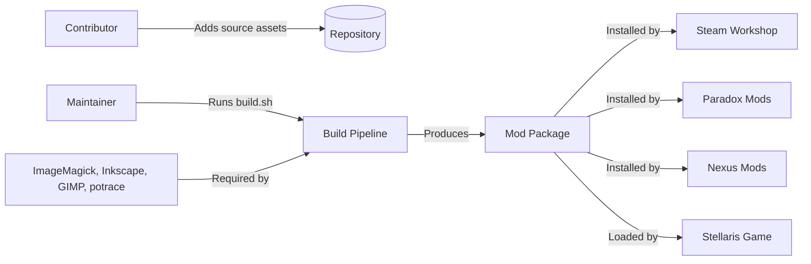
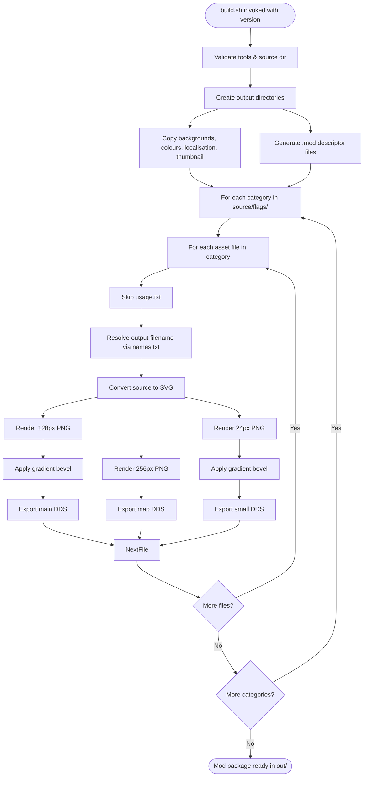

# Architecture

This document elaborates on the root [ARCHITECTURE.md](../ARCHITECTURE.md) with implementation-level detail for maintainers and contributors.

## Architectural Style

The repository follows a **pipeline-oriented asset processing architecture** with these characteristics:

- **Source-first organisation**: Assets authored in lossless/editable formats, grouped by thematic category
- **Declarative build script**: `build.sh` encodes the complete conversion pipeline as a sequence of format transformations
- **Immutable outputs**: Build writes to `build/` (intermediate) and `out/` (final); source assets never modified
- **Category isolation**: Each flag category processed independently, enabling parallelism and incremental builds

## System Context



### External Boundaries

| Boundary | Description | Contract |
|----------|-------------|----------|
| **Source Assets** | Contributor-provided flag designs in various formats | Files placed in `source/flags/<category>/` |
| **Build Tools** | ImageMagick (`convert`), Inkscape, GIMP (with DDS plug-in), potrace | Must be installed and discoverable via PATH or Flatpak |
| **Distribution Platforms** | Steam Workshop, Paradox Mods, Nexus Mods | Consume built mod package from `out/` |
| **Stellaris Game** | Loads mod package at runtime | Expects DDS textures + localisation/colour definitions |

## Architectural Areas

### 1. Source Assets Area

**Paths:**
- `source/flags/` — Category directories with flag source files and optional `usage.txt`
- `source/backgrounds/` — Background textures copied verbatim to output
- `source/colours.txt` — Colour palette definitions copied to `flags/colors.txt`
- `source/localisation.yml` — English localisation copied to `localisation/ui-flags_l_english.yml`
- `source/names.txt` — Mapping from source filename (without extension) to output filename
- `source/thumbnail.png` — Mod thumbnail copied to output root
- `source/scripts/` — GIMP Script-fu scripts for DDS export, SVG→PNG, XCF→PNG, gradient bevel

**Responsibilities:**
- Provide authoring formats and taxonomic organisation for flag designs
- Define naming overrides, colour palette, and localisation strings
- Supply reusable background textures and build-time scripts

**Boundary Rules:**
- Source files never modified by build
- Category directories define output category structure
- `names.txt` is single source of truth for output filenames

### 2. Build Pipeline Area

**Paths:**
- `build.sh` — Top-level orchestration, tool detection, directory management, conversion loop
- `source/scripts/*.lisp` — GIMP Script-fu implementations for format conversions and effects

**Responsibilities:**
- Detect and validate external tool dependencies
- Manage intermediate (`build/`) and final (`out/`) directory trees
- Execute conversion pipeline per asset: source → SVG → PNG (multiple sizes) → DDS
- Apply gradient bevel effect to main and small variants
- Generate Stellaris mod descriptor files

**Boundary Rules:**
- All file paths derived from repository root; no hardcoded absolute paths
- Tool binaries resolved via standard locations and Flatpak exports
- Intermediate build artefacts retained for incremental builds

### 3. Output Package Area

**Paths:**
- `out/ui-flags/` — Root of distributable mod package
- `out/ui-flags/flags/` — Category subdirectories with `map/`, `small/`, and main DDS files
- `out/ui-flags/flags/backgrounds/` — Copied background textures
- `out/ui-flags/flags/colors.txt` — Copied colour palette
- `out/ui-flags/localisation/ui-flags_l_english.yml` — Copied localisation
- `out/ui-flags/thumbnail.png` — Copied thumbnail
- `out/ui-flags.mod` and `out/ui-flags/descriptor.mod` — Mod descriptors

**Responsibilities:**
- Conform to Stellaris mod directory layout and descriptor format
- Provide DDS textures at required resolutions (128px, 256px, 24px)
- Include all metadata required by distribution platforms

**Boundary Rules:**
- Output structure fixed by Stellaris mod specification
- Descriptor files must contain correct version, name, path, tags, and supported_version

## Runtime Flow



### Principal Runtime Sequence

1. **Initialisation**: Validate required tools (ImageMagick, Inkscape, GIMP, potrace), verify source directory exists, parse version argument
2. **Static asset staging**: Copy backgrounds, colours.txt, localisation.yml, thumbnail.png to output layout; generate primary and secondary `.mod` descriptor files
3. **Category iteration**: For each subdirectory under `source/flags/`, create build and output subdirectories (main, map, small)
4. **Asset conversion**: For each asset file, resolve final filename via `names.txt`, convert source format to SVG, then render three PNG sizes (128px main, 256px map, 24px small), apply gradient bevel to main and small, export all three to DDS
5. **Completion**: Mod package resides in `out/ui-flags/` with descriptor files in `out/`

## Data Architecture

### Source Data Model

| Entity | Source | Format | Transformation |
|--------|--------|--------|----------------|
| Flag designs | `source/flags/<category>/` | SVG, AI, XCF, PNG, BMP | Converted to SVG → PNG → DDS |
| Background textures | `source/backgrounds/` | DDS | Copied verbatim |
| Colour palette | `source/colours.txt` | Stellaris colour format | Copied verbatim |
| Localisation | `source/localisation.yml` | YAML | Copied verbatim |
| Filename mapping | `source/names.txt` | Key=value pairs | Lookup during build |
| Thumbnail | `source/thumbnail.png` | PNG | Copied verbatim |

### Output Data Model

| Entity | Output Path | Format | Stellaris Requirement |
|--------|-------------|--------|----------------------|
| Main flag textures | `flags/<category>/*.dds` | DDS (BC1/BC3, mipmaps) | 128px, gradient bevel |
| Map flag textures | `flags/<category>/map/*.dds` | DDS (BC1/BC3, mipmaps) | 256px, no bevel |
| Small flag textures | `flags/<category>/small/*.dds` | DDS (BC1/BC3, mipmaps) | 24px, gradient bevel |
| Backgrounds | `flags/backgrounds/*.dds` | DDS | Copied from source |
| Colours | `flags/colors.txt` | Stellaris colour format | Copied from source |
| Localisation | `localisation/ui-flags_l_english.yml` | YAML | Copied from source |
| Thumbnail | `thumbnail.png` | PNG | Copied from source |
| Primary descriptor | `ui-flags.mod` | Stellaris descriptor format | Version, name, path, tags, supported_version |
| Secondary descriptor | `descriptor.mod` | Stellaris descriptor format | Same as primary |

## Interfaces and Integrations

### Build Tool Interface

| Tool | Purpose | Invocation | Failure Mode |
|------|---------|------------|--------------|
| `convert` (ImageMagick) | PNG → BMP flattening | `convert -background "#000" -flatten` | Exit code ≠ 0 |
| `inkscape` | AI → SVG, SVG rendering | `inkscape -f input -l output` | Exit code ≠ 0 |
| `gimp` | Script-fu execution | `gimp -i -b '(script)' -b '(gimp-quit 0)'` | Exit code ≠ 0 |
| `potrace` | BMP → SVG vectorisation | `potrace --opaque -s input -o output` | Exit code ≠ 0 |

### Distribution Platform Interface

| Platform | Integration Method | Artifact | Authentication |
|----------|-------------------|----------|----------------|
| Steam Workshop | GitHub Action (`steam-workshop.yml`) | `release/ui-flags/` directory | Steam credentials via secrets |
| Nexus Mods | GitHub Action (`nexus-mods.yml`) | `release.zip` | Nexus credentials via secrets |
| Paradox Mods | Manual upload | `release.zip` | Web UI |
| GitHub Releases | Manual/automated | `release.zip` | GitHub token |

## Dependency Direction and Rules

```
Source Assets → Build Pipeline → Output Package
                    ↓
              External Tools
                    ↓
           Distribution Platforms
                    ↓
              Stellaris Game
```

**Rules:**
- Source assets never depend on build outputs
- Build pipeline depends only on source assets and external tools
- Output package depends only on build pipeline
- Distribution platforms depend only on output package
- Stellaris depends only on output package (installed mod)

## External Dependencies

### Required Build Tools

| Tool | Minimum Version | Purpose | Installation |
|------|----------------|---------|--------------|
| ImageMagick | 6.x/7.x | PNG → BMP conversion | System package manager |
| Inkscape | 1.x | AI → SVG, SVG processing | System package manager / Flatpak |
| GIMP | 2.10+ | Script-fu execution, DDS export | System package manager / Flatpak |
| GIMP DDS plug-in | Compatible with GIMP | DDS format support | Separate installation |
| potrace | 1.x | BMP → SVG vectorisation | System package manager |

### Runtime Dependencies

| Dependency | Version | Purpose |
|------------|---------|---------|
| Stellaris | v4.5.* (configurable) | Game engine loading mod |
| Steam Workshop | N/A | Distribution platform |
| Paradox Mods | N/A | Distribution platform |
| Nexus Mods | N/A | Distribution platform |

## Deployment and Operations

### Build Process

```bash
./build.sh <version>
```

**Preconditions:**
- All required tools installed and in PATH or Flatpak locations
- Source directory exists with expected structure
- Version argument provided (semantic versioning)

**Postconditions:**
- Mod package in `out/ui-flags/`
- Descriptor files in `out/`
- Intermediate artefacts in `build/`

### Release Process

1. Tag release: `git tag v1.0.0 && git push origin v1.0.0`
2. GitHub Actions workflows trigger automatically
3. Workflows download release asset from GitHub Releases
4. Upload to Steam Workshop and Nexus Mods
4. Paradox Mods updated manually

### Environments

| Environment | Purpose | Configuration |
|-------------|---------|---------------|
| Local development | Building and testing mod | Full toolchain required |
| GitHub Actions | Automated releases | Ubuntu latest, tools pre-installed |
| Distribution platforms | Mod hosting | Platform-specific requirements |

## Compatibility Contracts

### Stellaris Mod Format

The output package must conform to:

- Directory structure: `flags/`, `localisation/`, `thumbnail.png`, `descriptor.mod`
- DDS format: BC1/BC3 compression with mipmaps
- Colour format: HSV/RGB definitions in `colors.txt`
- Localisation format: YAML with `l_english:` prefix
- Descriptor format: Key-value pairs with `version`, `name`, `path`, `tags`, `supported_version`

### Source Format Compatibility

| Input Format | Supported Features | Limitations |
|--------------|-------------------|-------------|
| SVG | Full vector support | Must be valid SVG 1.1 |
| AI | Adobe Illustrator | Requires Inkscape compatibility |
| XCF | GIMP native | Layers merged on export |
| PNG | Raster with transparency | Flattened to BMP for vectorisation |
| BMP | Raster | Intermediate format for potrace |

## Testing and Verification

### Manual Verification

1. Run `./build.sh <version>`
2. Verify `out/ui-flags/` structure matches expected layout
3. Check DDS files open correctly (GIMP, ImageMagick)
4. Install mod in Stellaris and verify flags appear in-game
5. Verify all three resolutions display correctly

### Automated Checks

- Tool validation at build start (exit on missing tools)
- Output file existence checks (skip already-processed assets)
- Descriptor file generation verification

### Known Gaps

- No automated visual regression testing
- No DDS format validation beyond file existence
- No Stellaris integration testing in CI

## Design Constraints

### Technical Constraints

1. **DDS format requirement**: Stellaris requires BC1/BC3 DDS with mipmaps
2. **Three resolutions mandatory**: 128px, 256px, 24px for main/map/small
3. **Gradient bevel signature**: Main and small variants must have bevel effect
4. **Tool availability**: Build requires specific external tools
5. **Flatpak support**: Tools may be installed via Flatpak on Linux

### Organisational Constraints

1. **Category taxonomy fixed**: New categories require localisation updates
2. **Filename mapping centralised**: `names.txt` is single source of truth
3. **Version argument mandatory**: Build cannot proceed without version
4. **GPL v3.0 licensing**: All contributions must be compatible

## Extension Points

### Adding New Flag Categories

1. Create directory under `source/flags/<new-category>/`
2. Add source flag files
3. Add category localisation to `source/localisation.yml`
4. Run build — category automatically discovered and processed

### Adding New Flag Assets

1. Place source file in appropriate `source/flags/<category>/`
2. Add entry to `source/names.txt` if custom output name needed
3. Run build — asset automatically processed

### Adding New Source Formats

1. Add conversion function to `build.sh` (e.g., `webp-to-svg`)
2. Add format detection in main loop
3. Ensure conversion produces valid SVG

### Modifying Colour Palette

1. Edit `source/colours.txt` with new HSV/RGB definitions
2. Run build — colours copied to output automatically

### Modifying Gradient Bevel

1. Edit `source/scripts/gradient-bevel.lisp`
2. Adjust bevel parameters (size, width, height, colours)
3. Run build — effect applied to main and small variants

## Source Map

| Component | Source Location | Documentation |
|-----------|----------------|---------------|
| Build orchestration | `build.sh` | [build-pipeline.md](./components/build-pipeline.md) |
| Format conversions | `build.sh` functions | [build-pipeline.md](./components/build-pipeline.md) |
| GIMP Script-fu scripts | `source/scripts/*.lisp` | [gimp-scripts.md](./components/gimp-scripts.md) |
| Source asset taxonomy | `source/flags/` | [source-assets.md](./components/source-assets.md) |
| Output packaging | `build.sh` main loop | [output-package.md](./components/output-package.md) |
| CI/CD workflows | `.github/workflows/*.yml` | [build-and-deployment.md](./build-and-deployment.md) |

## Related Documentation

- [Root ARCHITECTURE.md](../ARCHITECTURE.md) — High-level architecture overview
- [Repository Overview](./repository-overview.md) — Purpose, scope, entry points
- [Repository Structure](./repository-structure.md) — Source tree layout
- [Build and Deployment](./build-and-deployment.md) — Build pipeline, deployment, environments
- [Components](./components/) — Per-component deep dives
- [Flows](./flows/) — End-to-end execution flows